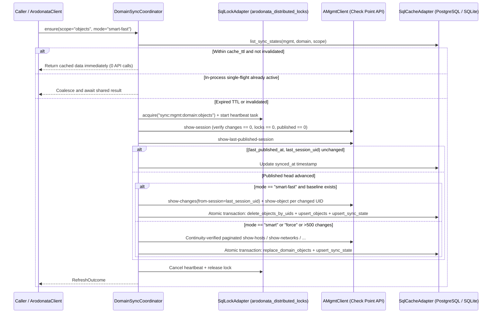

# Caching, Incremental Synchronization & Search

Arodonata v2 coordinates multi-domain synchronization through `DomainSyncCoordinator` (`src/arodonata/core/services/sync_coordinator.py`) and exposes four cache freshness modes (`CacheMode`).

## 1. The Four `CacheMode` Policies

| Mode | Staleness Probe (`show-last-published-session`) | Data Fetch Strategy | Typical Use Case |
| --- | --- | --- | --- |
| `"cache"` | Never | Local SQLite/PostgreSQL query only (`0` API calls) | High-speed rulebase filtering, offline analysis, MCP `query_objects` |
| `"smart"` (default) | Only when `synced_at` is older than `cache_ttl` (or after `invalidate_domain`) | Full atomic type-slice reload if `(last_published_at, last_session_uid)` changed | Default SDK reads (`get_hosts`, `get_services`, `get_gateways`) |
| `"smart-fast"` | Same as `"smart"` | Queries `show-changes` (`from-session` or UTC `from-date`), deletes removed UIDs, re-fetches added/modified UIDs via `show-object`, and applies dialect `ON CONFLICT` upserts; falls back to full reload if changes `> max_incremental_changes` (`500`) | Rapid refresh after small publishes across large domains |
| `"force"` | Always probes current publish head | Unconditional atomic reload of all requested types | Initial cache build or forced recovery |

## 2. Synchronization Pipeline & Safeguards

### Critical Invariants

- **Dirty Shared Session Refusal (`DirtySessionError`)**: Before syncing any domain into the shared cache, `DomainSyncCoordinator` verifies via `show-session` that `locks == 0`, `changes == 0`, and `number-of-published-changes == 0` (failing closed if `show-session` fails). Uncommitted changes are never written into shared SQL tables.
- **Process-Wide Concurrency & Single-Flight Coalescing (`_ProcessSyncRegistry`)**: Coordinators sharing a database engine share event-loop-bound per-MDS-member semaphores and an `_InFlightDomainSync` registry so concurrent coroutines syncing the same domain coalesce without duplicate API probes or lock contention. Default `domain_sync_concurrency` is `min(2, max(1, concurrent_limit - 1))` unless overridden via `ARODONATA_DOMAIN_SYNC_CONCURRENCY`, and re-entrant nested `ensure` calls reuse `_HELD_MDS_PERMITS` without deadlocking.
- **Lock Contention vs Genuine Failure**: If another worker holds the per-domain lock (`LockAcquisitionError`), the coordinator skips redundant work without marking `arodonata_domain_sync_state.status = "failed"`. Genuine API or credential errors record a sanitized (`redact_sid`) error in `last_error` while preserving previously cached rows.

## 3. Search, Structured Queries & Recursive Group Membership (`SearchService`)

`await client.search_objects(query, ..., exact_match=False, max_depth=2)` classifies each comma-separated term via `classify_search_term()` into `"ipv4"`, `"cidr"`, `"range"`, `"wildcard"`, `"uid"`, or `"name"` and searches across `arodonata_objects` (plus `arodonata_assets` including interface IPv4s when asset types are specified, and any active `WriteSession` overlay):

1. **IPv4 Address (`10.1.10.50`)**: Matches hosts with that IPv4 address, networks whose CIDR subnet contains the IP, and address ranges whose `[first..last]` bounds include the IP.
2. **CIDR Subnet (`10.1.10.0/24`)**: Matches networks with that subnet/mask and hosts/subnets contained within it (with containment excluded when `exact_match=True`).
3. **IPv4 Range (`10.1.10.1-10.1.10.20`)**: Matches overlapping `address-range` objects and contained hosts.
4. **Wildcard Pattern (`*.corp.example`, `web-*`)**: Evaluates case-insensitive anchored `fnmatchcase` across `name`, `uid`, `object_id`, `id`, `fqdn`, `ipv4_address`, `subnet4`, and `comments`.
5. **UUID Identifier (`<uid>`)**: Matches `CPObject.uid` or composite `id` directly.
6. **Exact or Substring Name (`exact_match=True` vs `False`)**:
   - When `exact_match=False` (default), matches case-insensitive substrings in `name`, `fqdn`, `object_id`, `id`, and `comments`.
   - When `exact_match=True`, matches only exact case-insensitive `name`, `fqdn`, `object_id`, `id`, or `uid` (e.g., searching `".example.com"` with `exact_match=True` matches `.example.com` without matching `sub.example.com`).
7. **Recursive Group Resolution (`max_depth`)**: Traverses `group.members` upward up to `max_depth` levels, returning `SearchResult(query=..., matches=[...], memberships=...)` where each `GroupMembershipNode` carries `id`, `object_id`, `uid`, `name`, `mgmt_name`, `domain_name`, `depth`, `parent_uids`, and `parent_object_ids`.

`SearchService` also provides:

- `describe_objects()` and `query_objects()` for cross-domain SQL-backed filtering (`scope_origin="local"|"global"|"all"`, `ip_subnet`, `port`, `protocol`, `tags`), `group_by` aggregation with CPMI type aliases, and `aggregate="count" | "list" | "describe"`.
- `get_cache_status()` inspecting `arodonata_domain_sync_state` per `(mgmt_name, domain_name, scope, item_type)`.
- `get_group_members()` / `resolve_group_with_members()` resolving recursive group, service-group, cluster, and cross-domain VSX members while raising `AmbiguousObjectError` if an unqualified name matches multiple cached domains.

## 4. Cross-Domain Asset Topology & Composite Identifiers

During `refresh_assets` / `stream_refresh_assets`, `AssetRefreshService` runs `ClusterRelationshipManager` and `VSXRelationshipManager` across cached domain assets:

- **Intra-Domain Cluster Members**: Links each cluster (`CpmiGatewayCluster`, `vsx-cluster-netobj`) and its members (`CpmiClusterMember`, `vsx-cluster-member`) with both UID references (`parent_uid`, `member_uids`) and composite identifiers (`parent_id`, `parent_asset_id`, `member_asset_ids`).
- **Cross-Domain VSX Virtual Systems**: Reconciles VSX relationships across all domains on the same `mgmt_name` (including `CpmiVsxSlotObj` / `CpmiVsSlotObj` interface and route inheritance), populating `parent_id` (`"mds:VSX:<vsx-uid>"`), `parent_asset_id` (`"mds:VSX:<vsx-name>"`), `virtual_system_uids`, and `virtual_system_asset_ids` (`["mds:Domain4:<vs-name>"]`).

## 5. Explicit Background Cache Warm-Up

`client.start_object_cache_warmup(...)` starts non-blocking background cache warming coalesced across callers via `_WarmupFlightKey` (`(mgmt_name, domains, types, include_global, include_services, mode == "force")`). `get_domains()` never triggers implicit warm-up, while `client.get_warmup_status()` reports SID-redacted per-server progress (`WarmupStatusEntry`). On `client.close()`, active warm-up tasks are cancelled cleanly.

## 6. Gateway Topology & Live Route Sync (`TopologyService`)

`TopologyService` combines Check Point static interface/VPN/VS-route extraction with live CLI routing diagnostics:

- **Targeted On-Demand Extraction**: Expands interface specific-network groups on demand via targeted `show-object` / `show-group` lookups rather than downloading every host/network object in a domain.
- **Live Route Collection**: Executes route collection scripts bounded by `route_collect_concurrency` (default `min(4, max(1, concurrent_limit // 2))`) and serialized per VSX physical chassis node, trying `GatewayCliPort` (SSH) first and falling back to Check Point `cprid` `run-script` (via `ScriptRepositoryService` in `"auto"` or `"repository"` mode, or inline bash).
- **Reconciliation, Confidence & Matching**: Persists 64-bit IPv4 intervals into `arodonata_gateway_topology`, honors persistent `arodonata_topology_annotations` (`ignore`, `standby_dynamic`, `trust_static_topology`), computes `ConfidenceDelta` scores using `TopologyConfidenceWeights` and policy rule evidence, and exposes `reconcile_gateway_topology()`, `get_topology_diagnostics()`, `find_affected_gateways()`, and `export_topology_prefixes()`.

## 7. Rulebase Snapshots & Selective Package Refresh

`RulebaseRefreshService` and `CachedRulebaseSource` maintain normalized SmartConsole-compatible rulebase caches across the 7 `arodonata_rulebase_*` tables:

- `refresh_policy_packages()` populates the lightweight `arodonata_rulebase_package_layer` catalog without downloading all rule rows.
- `refresh_package_rulebase()` atomically updates only the target package's layers, inline layers, sections, and NAT package rows (`upsert_domain_rulebase_layers`) without overwriting other packages in the domain.
- `RulebasePager` stitches sections split across 100-rule pagination boundaries and probes trailing empty sections; `CachedRulebaseSource` supports offline hierarchical numbering (`1`, `2.1`, `3`), `locate_rules()`, and `filter_rulebase()` (`output_format="objects" | "markdown" | "model_friendly" | "cpcrud"`).
