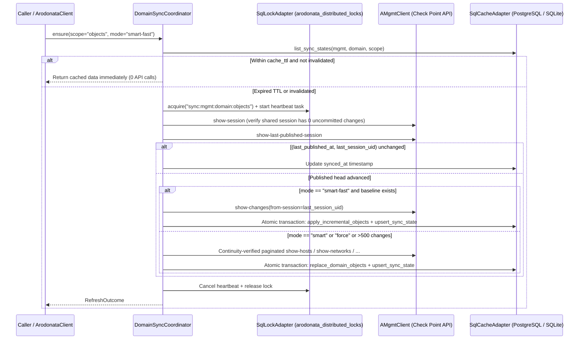

# Caching, Incremental Synchronization & Search

Arodonata v2 coordinates multi-domain synchronization through `DomainSyncCoordinator` (`src/arodonata/core/services/sync_coordinator.py`) and exposes four cache freshness modes (`CacheMode`).

## 1. The Four `CacheMode` Policies

| Mode | Staleness Probe (`show-last-published-session`) | Data Fetch Strategy | Typical Use Case |
| --- | --- | --- | --- |
| `"cache"` | Never | Local SQLite/PostgreSQL query only (`0` API calls) | High-speed rulebase filtering, offline analysis, MCP `query_objects` |
| `"smart"` (default) | Only when `synced_at` is older than `cache_ttl` (or after `invalidate_domain`) | Full atomic type-slice reload if `(last_published_at, last_session_uid)` changed | Default SDK reads (`get_hosts`, `get_services`, `get_gateways`) |
| `"smart-fast"` | Same as `"smart"` | Queries `show-changes` (`from-session` or UTC `from-date`) and applies dialect `ON CONFLICT` upserts/deletes; falls back to full reload if changes `> max_incremental_changes` (`500`) | Rapid refresh after small publishes across large domains |
| `"force"` | Always probes current publish head | Unconditional atomic reload of all requested types | Initial cache build (`04_smart_refresh.py`) or forced recovery |

## 2. Synchronization Pipeline & Safeguards

### Critical Invariants

- **Dirty Shared Session Refusal (`DirtySessionError`)**: Before syncing any domain into the shared cache, `DomainSyncCoordinator` verifies via `show-session` that the session has `changes == 0`. It never caches uncommitted objects into the shared SQL tables.
- **Per-MDS-Member Concurrency**: Domains hosted on the same `active_mds_ip` are refreshed concurrently via `asyncio.TaskGroup` up to `max(1, concurrent_limit - 1)` at a time, leaving at least one rate-limiter slot free for interactive API calls.
- **Lock Contention vs Genuine Failure**: If another worker holds the per-domain lock (`LockAcquisitionError`), the coordinator skips redundant work without marking `arodonata_domain_sync_state.status = "failed"`. Genuine API or credential errors record a sanitized (`redact_sid`) error in `last_error` while preserving previously cached rows.

## 3. Search & Recursive Group Membership (`SearchService`)

`await client.search_objects(query, ..., exact_match=False, max_depth=2)` classifies each comma-separated term in `query` and searches across `arodonata_objects` (plus any active `WriteSession` overlay):

1. **IPv4 Address (`10.1.10.50`)**: Matches hosts with that IPv4 address, networks whose CIDR subnet contains the IP, and address ranges whose `[first..last]` bounds include the IP.
2. **CIDR Subnet (`10.1.10.0/24`)**: Matches networks with that subnet/mask and hosts/subnets contained within it.
3. **IPv4 Range (`10.1.10.1-10.1.10.20`)**: Matches overlapping `address-range` objects and contained hosts.
4. **Wildcard Pattern (`*.corp.example`, `web-*`)**: Evaluates case-insensitive anchored `fnmatchcase` across object names and `fqdn` fields.
5. **Composite Identifier (`mds:Domain4:hWebHost` or `mds:Domain4:<uid>`)**: Matches `CPObject.object_id` or `CPObject.id` directly (case-insensitively on `object_id`).
6. **Exact or Substring Name (`exact_match=True` vs `False`)**:
   - When `exact_match=False` (default), matches case-insensitive substrings in `name`, `fqdn`, `object_id`, and `comments`.
   - When `exact_match=True`, matches only exact case-insensitive `name`, `fqdn`, `object_id`, or `id` (e.g., searching `".example.com"` with `exact_match=True` matches `.example.com` without matching `sub.example.com`).
7. **Recursive Group Resolution (`max_depth`)**: Automatically traverses `group.members` upward up to `max_depth` levels, returning both `SearchResult.objects` and `SearchResult.memberships` (`object_uid -> list[GroupMembershipNode]`, where each `GroupMembershipNode` carries `uid`, `name`, `type`, `domain`, `id`, `object_id`, `depth`, `parent_uids`, and `parent_object_ids`).

## 4. Cross-Domain Asset Topology & Composite Identifiers

During `refresh_assets` / `stream_refresh_assets`, `AssetRefreshService` runs `ClusterRelationshipManager` and `VSXRelationshipManager` across cached domain assets:

- **Intra-Domain Cluster Members**: Links each cluster (`CpmiGatewayCluster`, `vsx-cluster-netobj`) and its members (`CpmiClusterMember`, `vsx-cluster-member`) with both UID references (`parent_uid`, `member_uids`) and composite identifiers (`parent_id`, `parent_asset_id`, `member_asset_ids`).
- **Cross-Domain VSX Virtual Systems**: On Multi-Domain Security Management (MDSM), a physical VSX gateway or cluster typically lives in an infrastructure domain (e.g., `"VSX"`) while its Virtual Systems (`virtual-system`) reside in tenant domains (e.g., `"Domain4"`). `AssetRefreshService` reconciles VSX relationships across all domains on the same `mgmt_name`, populating `parent_id` (`"mds:VSX:<vsx-uid>"`), `parent_asset_id` (`"mds:VSX:<vsx-name>"`), `virtual_system_uids`, and `virtual_system_asset_ids` (`["mds:Domain4:<vs-name>"]`).
