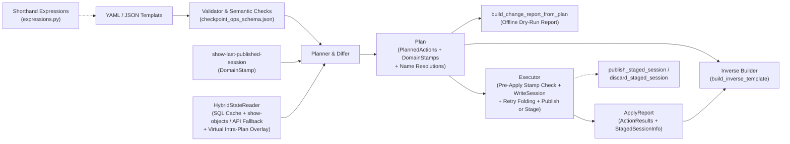

# CPCRUD Engine Architecture

`arodonata.cpcrud` (`src/arodonata/cpcrud/`) implements a deterministic, two-phase (`plan` → `apply`) Policy-as-Code engine for Check Point Security Management and MDSM.

## Architecture & Data Flow

## Core Components

### 1. Offline Schema & Semantic Validator (`validator.py`)

`CPCRUDService.validate()` validates YAML strings or Python dictionaries against `src/arodonata/cpcrud/checkpoint_ops_schema.json` (or `cpcrud_schema_path`, JSON Schema Draft-07) with zero network or database calls. Beyond JSON Schema, semantic checks enforce strict `(object_type, operation)` command allowlisting, reject `add` operations on `application-site` missing both `url-list` and `application-signature`, and validate incremental `{add, remove}` delta mappings.

### 2. `DomainStamp` & `HybridStateReader` (`state_reader.py`)

Before inspecting any objects or rules, `Planner` queries `show-last-published-session` for each target domain and records a `DomainStamp(mgmt_name, domain, last_session_uid, last_published_at)`.

`HybridStateReader` serves object, service, and rule lookups using a tiered strategy:

- **Cache Hit (Fast Path)**: If `arodonata_domain_sync_state` for `(mgmt_name, domain, scope, item_type)` matches the planner's `DomainStamp` (`last_published_at` and `last_session_uid`), lookups (`host`, `network`, `address-range`, `group`, `dns-domain`, `application-site`, `service-tcp`, `service-udp`, `service-icmp`, etc.) resolve directly from `arodonata_objects` and `arodonata_services` in local SQL.
- **Targeted Cold-Cache API Lookup**: When local cache is cold or stale, `HybridStateReader` first issues targeted `show-objects` queries (`filter` + `ip-only=True`)—with `application-site` value-matching using normalized `url-list` keys (`normalize_app_site_url_key`)—before falling back to full paginated `api_query` (`show-hosts`, `show-services-tcp`, etc.) only when necessary (e.g., `generic_err_command_not_recognized` or ICMP type/code lookups).
- **Intra-Plan Virtual State Overlay**: Each `plan()` call instantiates a fresh `HybridStateReader` whose virtual overlay tracks objects, services, and groups planned earlier in the same template so downstream groups and rules see newly planned members immediately.
- **Fail-Closed Lookup Errors**: Transport or API errors during state lookup raise `StateLookupError` and produce `Outcome.ERROR` (plus `Outcome.SKIPPED_DEPENDENCY` on dependent groups/rules) rather than falsely assuming an object is missing and planning a duplicate `CREATE`.

### 3. Two-Axis Conflict Resolution (`differ.py` & `planner.py`)

When planning an object or service:

- **`on_name_conflict: "update" | "error"`**:
  - If an object with the same `name` exists with identical desired fields → `Outcome.UNCHANGED` (`no-op`).
  - If fields differ and `on_name_conflict="update"` → `Outcome.UPDATE` with field-level `FieldChange` diffs.
  - If fields differ and `on_name_conflict="error"` → `Outcome.ERROR`.
- **`on_ip_conflict: "reuse" | "create_new" | "error"`**:
  - Evaluated when no object has the requested `name`, but an existing object in the domain already owns the same IPv4/IPv6 value, CIDR subnet, IP range, port/ICMP tuple, DNS FQDN, or `application-site` URL set:
  - `"reuse"` (default): Plans `Outcome.REUSE` and records `requested_name -> existing_name` in `Plan.name_resolutions`, automatically rewriting references in subsequent groups and rules.
  - `"create_new"`: Generates a convention name via `NamingPrefixes` (`Host_<ip>`, `Net_<subnet>_<mask>`, `IPR_<first>-<last>` or compressed same-`/24`, `TCP_<port>`, `UDP_<port>`, `ICMP_<type>[_<code>]`, `grp<name><suffix>`, `Site_[marker]<domain>`) and plans `Outcome.CREATE` (or reuses if that canonical name already exists).
  - `"error"`: Plans `Outcome.ERROR` and skips dependent actions.

### 4. Rule Identity & Cleanup-Aware Positioning (`rule_identity.py` & `position_helper.py`)

- **Access, HTTPS, and Threat Rules**: Matched by `uid`, `name`, or traffic tuple (`source`, `destination`, `service`, `action`).
- **NAT Rules**: Matched by `uid`, `name`, or original/translated traffic tuple, normalizing Check Point's built-in `"Original"` (`NAT_ORIGINAL_OBJECT_UID`) and `"Any"` (`NAT_ANY_OBJECT_UID`) sentinel UIDs so re-planning an applied NAT rule is idempotent (`Outcome.UNCHANGED`).
- **Cleanup Rule Anchoring**: `is_cleanup_rule()` identifies any rule with `"cleanup"` in its name or any trailing `Any / Any / Any` rule at the end of a layer or section. When `position: "bottom"` or `{"bottom": "<section>"}` is requested alongside a trailing cleanup rule, `position_helper` automatically anchors the new rule `{"above": "<cleanup_rule_uid>"}` so traffic rules are never placed below the cleanup drop rule.

### 5. Dedicated-Session `Executor` & Compensating Rollback (`executor.py`, `inverse.py`)

When `await client.cpcrud.apply(plan, force=False)` runs:

1. **Pre-Session Staleness Check**: Re-queries `show-last-published-session` and compares against `plan.domain_stamps`. If another admin published changes after `plan()` was created and `force=False`, execution aborts with `Outcome.PLAN_STALE` before opening a write session.
2. **Pre-Publish Drift Re-Verification**: Before calling `publish`, `Executor` re-checks `show-last-published-session`; if concurrent changes published during execution (`force=False`), it discards the session cleanly and reports `Outcome.PLAN_STALE`.
3. **Bounded Retries (`retry_remaining`)**: `Executor.stream_apply` can re-run failed actions up to `retry_remaining` times, advancing `DomainStamp` only for domains published by the executor and folding retry results into a cumulative `ApplyReport`.
4. **Compensating Rollback (`inverse.py`)**: `client.cpcrud.inverse(plan, report=None)` supports both post-apply rollback (`Outcome.CREATE`, `Outcome.UPDATE`, `Outcome.DELETE` using `prior_state`, requiring a concrete `target_uid` on `CREATE`) and pre-apply dry-run inversion, emitting a schema-valid reverse template in reverse dependency order (rules → sections → groups → services/objects).

### 6. Shorthand Expression Parser (`expressions.py`)

`arodonata.cpcrud.expressions` parses concise operator strings into normalized Check Point object/service dictionaries using `NamingPrefixes`: `parse_object_expression()`, `parse_service_expression()`, `parse_group_expression()`, `expand_group_expression()`, `parse_app_site_expression()`, `parse_range_token()`, `normalize_wildcard_domain()`, and `wildcard_domain_to_cp_regex_urls()` (covering hosts, CIDRs, short IP ranges like `10.1.1.1-9`, `tcp/udp/icmp` tokens, DNS sub-domains, wildcard `application-site` regex URLs, and nested group trees).

### 7. Incremental Group & Rule Cell Deltas (`DiffSafetyError`)

`differ.py` supports incremental `{add, remove}` dictionaries on `group.members`, `service-group.members`, `application-site.url-list`, and rule cells (`source`, `destination`, `service`, `install-on`, `protected-scope`, `site-category`), raising `DiffSafetyError` to prevent unsafe mutations (adding `'Any'`, narrowing an existing `'Any'` cell without explicitly removing `'Any'`, or emptying a rule cell or `url-list` without `application-signature`). Missing named targets under `"set"` or incremental delta updates fail closed as `Outcome.ERROR`.

### 8. Staged Sessions & Offline Dry-Run `ChangeReport`

- **Staged Sessions**: Calling `apply(plan, no_publish=True, keep_session=True)` leaves the dedicated write session uncommitted for external inspection (`ApplyReport.staged_sessions` with `StagedSessionInfo`, `sid` redacted), emits `StagedSessionEvent`, and supports later provenance-verified adoption (`take-over-session` / `switch-session`) via `publish_staged_session()` and `discard_staged_session()`.
- **Offline Plan Reports**: `build_change_report_from_plan(plan)` (`arodonata.reports.plan_report`) converts any `Plan` directly into a `ChangeReport` renderable via `render_change_report()` (`html`, `markdown`, `json`) without live API calls.
