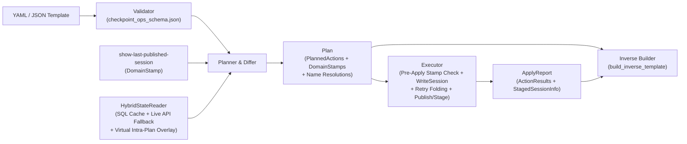

# CPCRUD Engine Architecture

`arodonata.cpcrud` (`src/arodonata/cpcrud/`) implements a deterministic, two-phase (`plan` → `apply`) Policy-as-Code engine for Check Point Security Management and MDSM.

## Architecture & Data Flow

## Core Components

### 1. Offline Schema Validator (`validator.py`)

Validates YAML strings or Python dictionaries against `src/arodonata/cpcrud/checkpoint_ops_schema.json` (JSON Schema Draft-07) with zero network or database calls. Checks structural requirements, object/service/group/section/rule types, conflict policies, and strict `(object_type, operation)` command allowlisting.

### 2. `DomainStamp` & `HybridStateReader` (`state_reader.py`)

Before inspecting any objects or rules, `Planner` queries `show-last-published-session` for each target domain and records a `DomainStamp(mgmt_name, domain, last_session_uid, last_published_at)`.

`HybridStateReader` then serves object and service lookups using a two-tier strategy:

- **Cache Hit (Fast Path)**: If `arodonata_domain_sync_state` for `(mgmt_name, domain, scope, item_type)` matches the planner's `DomainStamp` (`last_published_at` and `last_session_uid`), lookups (`host`, `network`, `address-range`, `group`, `dns-domain`, `service-tcp`, `service-udp`, etc.) are resolved directly from `arodonata_objects` and `arodonata_services` in local SQL.
- **Live API Fallback**: If the domain cache is absent or older than the `DomainStamp`, `HybridStateReader` falls back transparently to live Check Point API queries.
- **Intra-Plan Virtual State Overlay**: Each `plan()` call instantiates a fresh `HybridStateReader` whose virtual overlay tracks objects, services, and groups planned earlier in the same template so downstream groups and rules see newly planned members immediately.
- **Fail-Closed Lookup Errors**: Transport or API errors during state lookup raise `StateLookupError` and produce `Outcome.ERROR` (plus `Outcome.SKIPPED_DEPENDENCY` on dependent groups/rules) rather than falsely assuming an object is missing and planning a duplicate `CREATE`.

### 3. Two-Axis Conflict Resolution (`differ.py` & `planner.py`)

When planning an object or service:

- **`on_name_conflict: "update" | "error"`**:
  - If an object with the same `name` exists with identical desired fields → `Outcome.UNCHANGED` (`no-op`).
  - If fields differ and `on_name_conflict="update"` → `Outcome.UPDATE` with field-level `FieldChange` diffs.
  - If fields differ and `on_name_conflict="error"` → `Outcome.ERROR`.
- **`on_ip_conflict: "reuse" | "create_new" | "error"`**:
  - Evaluated when no object has the requested `name`, but an existing object in the domain already owns the same IPv4 address, CIDR subnet, IP range, or TCP/UDP port:
  - `"reuse"` (default): Plans `Outcome.REUSE` and records `requested_name -> existing_name` in `Plan.name_resolutions`, automatically rewriting references in subsequent groups and rules.
  - `"create_new"`: Generates a canonical convention name via `NamingPrefixes` (`Host_<ip>`, `Net_<subnet>_<mask>`, `IPR_<first>-<last>`, `TCP_<port>`, `UDP_<port>`) and plans `Outcome.CREATE` (or reuses if that canonical name already exists).
  - `"error"`: Plans `Outcome.ERROR` and skips dependent actions.

### 4. Rule Identity & Cleanup-Aware Positioning (`rule_identity.py` & `position_helper.py`)

- **Access, HTTPS, and Threat Rules**: Matched by `uid`, `name`, or traffic tuple (`source`, `destination`, `service`, `action`).
- **NAT Rules**: Matched by `uid`, `name`, or original/translated traffic tuple, normalizing Check Point's built-in `"Original"` (`NAT_ORIGINAL_OBJECT_UID`) and `"Any"` (`NAT_ANY_OBJECT_UID`) sentinel UIDs so re-planning an applied NAT rule is 100% idempotent (`Outcome.UNCHANGED`).
- **Cleanup Rule Anchoring**: When `position: "bottom"` is requested on an access layer whose bottom rule is an explicit Check Point cleanup rule (`name="Cleanup rule"` or `action="Drop"` with `Any/Any/Any`), `position_helper` automatically anchors the new rule `{"above": "<cleanup_rule_uid>"}` so traffic rules are never placed below the cleanup drop rule.

### 5. Dedicated-Session `Executor` & Staleness Guard (`executor.py`)

When `await client.cpcrud.apply(plan, force=False)` runs:

1. **Pre-Session Staleness Check**: Re-queries `show-last-published-session` and compares against `plan.domain_stamps`. If another admin published changes after `plan()` was created and `force=False`, execution aborts with `Outcome.PLAN_STALE` before opening a write session.
2. **Pre-Publish Drift Re-Verification**: Before calling `publish` at the end of a domain's action batch, `Executor` re-checks `show-last-published-session` a second time; if concurrent changes were published while actions were running and `force=False`, it discards the session and reports `Outcome.PLAN_STALE`.
3. **Compensating Rollback (`inverse.py`)**: `client.cpcrud.inverse(plan, report)` inspects only actions that actually succeeded (`Outcome.CREATED`, `Outcome.UPDATED`, `Outcome.DELETED`) in `ApplyReport` and generates a schema-valid reverse template (`delete` for `CREATED`, `set` with `before` values for `UPDATED`, `add` with `before_snapshot` for `DELETED`) in reverse dependency order (rules → sections → groups → services/objects).
