# Database Schema Reference (15 `arodonata_*` Tables)

Arodonata v2 persists all cached topology, shared sessions, distributed locks, objects, services, gateway/VSX assets, and normalized policy rulebases across **15 SQLModel tables** defined in `src/arodonata/adapters/storage/tables.py` (`ARODONATA_TABLE_NAMES`).

Both **PostgreSQL (`postgresql+asyncpg://`)** and **SQLite (`sqlite+aiosqlite://`)** are first-class supported backends.

---

## 1. Host Application Coexistence & Auto-Migration Design

Arodonata v2 is engineered to share a single database and `SQLModel.metadata` registry safely with host applications (such as **FPCR v2**):

1. **Strict `arodonata_` Table Namespace (`ARODONATA_TABLE_NAMES`)**:
   - Every table owned by Arodonata is prefixed with `arodonata_` (including `arodonata_assets`, `arodonata_domains`, `arodonata_distributed_locks`, `arodonata_sid_cache`, `arodonata_domain_sync_state`).
   - `DatabaseManager.initialize()` inspects and migrates **only** tables in `ARODONATA_TABLE_NAMES`. Any host application tables in the same database or `SQLModel.metadata` (such as a host app's own `assets` or `domains` table) are never touched, altered, or dropped.
2. **SHA-256 Schema Hash Auto-Migration (`arodonata_schema_version`)**:
   - `DatabaseManager` computes a deterministic SHA-256 digest (`compute_schema_hash()`) over the table names, column names, SQL types, primary keys, nullability, and indexes of all 15 `arodonata_*` tables.
   - If the current `schema_hash` is already recorded in `arodonata_schema_version` and all 15 tables exist, startup skips column inspection and completes in `< 2ms`.
   - When the schema evolves, `DatabaseManager` adds missing columns/indexes via savepoint-protected (`begin_nested()`) `ALTER TABLE` statements—or drops and recreates ephemeral `arodonata_*` cache tables if primary keys or `NOT NULL` constraints changed—and records the new `schema_hash`.
3. **Cross-Worker Migration Serialization**:
   - Multi-worker Uvicorn/Gunicorn startups are serialized using `SELECT pg_advisory_xact_lock(...)` on PostgreSQL and `BEGIN IMMEDIATE` on SQLite, with a double-check of `arodonata_schema_version` after acquiring the lock.
4. **Legacy v1 Table Fingerprint Cleanup**:
   - If upgrading an existing database from Arodonata v1, `DatabaseManager` drops legacy unprefixed `domains` or `sid_cache` tables **only** if they contain positive v1 column fingerprints (`mdm_dmn` or `mgmt_dmn_key`), guaranteeing zero risk to unprefixed host tables.
5. **Naive UTC Timestamp Uniformity (`DateTime(timezone=False)`)**:
   - Every timestamp column in Arodonata uses `Column(DateTime(timezone=False))` normalized via `to_naive_utc()` (`tzinfo=None` in UTC), preventing `asyncpg` offset-naive vs offset-aware errors on PostgreSQL.
6. **UID Primary Keys (`id`) + Human-Readable Composite Identifiers (`object_id`, `service_id`, `asset_id`)**:
   - Check Point permits distinct objects in the same domain (or visible from `Global`) to share the same `name` across different object classes (e.g., built-in objects named `email`) while having distinct `uid` values, and allows existing objects to be renamed across publishes.
   - Therefore, `arodonata_objects`, `arodonata_services`, and `arodonata_assets` retain a UID-based primary key `id = "{mgmt_name}:{domain_name}:{uid}"` (preventing primary-key collisions and orphaned rows on rename during `smart-fast` incremental sync) while simultaneously exposing an indexed, non-unique human-readable composite identifier:
     - `CPObject.object_id` (`arodonata_objects.object_id`): `"{mgmt_name}:{domain_name}:{name}"`
     - `CPService.service_id` (`arodonata_services.service_id`): `"{mgmt_name}:{domain_name}:{name}"`
     - `Asset.asset_id` (`arodonata_assets.asset_id`): `"{mgmt_name}:{domain_name}:{name}"`
   - In addition, `arodonata_assets` maintains dual UID and human-readable parent/child topology links (`parent_uid`, `parent_name`, `parent_id`, `parent_asset_id`, `member_uids`, `member_asset_ids`, `virtual_system_uids`, and `virtual_system_asset_ids`), supporting both intra-domain clusters and **cross-domain VSX topology** (where a physical VSX gateway/cluster resides in an infrastructure domain like `VSX` and its Virtual Systems reside in tenant domains like `Domain4`).

---

## 2. Entity-Relationship Diagram (15 Tables)

```mermaid
erDiagram
    arodonata_schema_version {
        string schema_hash PK
        datetime applied_at
    }
    arodonata_distributed_locks {
        string lock_key PK
        string owner_id "INDEX"
        datetime acquired_at
        datetime expires_at "INDEX"
    }
    arodonata_domains {
        string id PK "mgmt_name:name"
        string mgmt_name "INDEX"
        string uid "INDEX"
        string name "INDEX"
        string domain_type
        string active_ip
        string active_mds_ip "INDEX"
        boolean is_global "INDEX"
        datetime updated_at
    }
    arodonata_sid_cache {
        string id PK "mgmt_name:domain_name:auth_hash"
        string mgmt_name "INDEX"
        string domain_name "INDEX"
        string sid "REDACTED in repr"
        string server_ip
        string session_uid
        string auth_identity
        datetime last_used_at
        datetime expires_at
    }
    arodonata_domain_sync_state {
        string id PK "mgmt_name:domain_name:scope:item_type"
        string mgmt_name "INDEX"
        string domain_name "INDEX"
        string scope "INDEX: domains|objects|services|assets|rulebase"
        string item_type "INDEX: host|network|*|..."
        datetime last_published_at
        string last_session_uid
        datetime synced_at
        string status "idle|syncing|ok|failed"
        int object_count
        string last_error
    }
    arodonata_objects {
        string id PK "mgmt_name:domain_name:uid"
        string object_id "INDEX: mgmt_name:domain_name:name"
        string uid "INDEX"
        string name "INDEX"
        string type "INDEX: host|network|address-range|group|dns-domain"
        string mgmt_name "INDEX"
        string domain_name "INDEX"
        string original_domain "INDEX"
        string ipv4_address "INDEX"
        string subnet4 "INDEX"
        int mask_length4
        string fqdn "INDEX"
        json members
    }
    arodonata_services {
        string id PK "mgmt_name:domain_name:uid"
        string service_id "INDEX: mgmt_name:domain_name:name"
        string uid "INDEX"
        string name "INDEX"
        string type "INDEX: service-tcp|service-udp|service-icmp|service-group|..."
        string mgmt_name "INDEX"
        string domain_name "INDEX"
        string original_domain "INDEX"
        string port "INDEX"
        string protocol "INDEX"
        json members
    }
    arodonata_assets {
        string id PK "mgmt_name:domain_name:uid"
        string asset_id "INDEX: mgmt_name:domain_name:name"
        string uid "INDEX"
        string name "INDEX"
        string type "INDEX: simple-gateway|CpmiGatewayCluster|vsx-gateway|..."
        string mgmt_name "INDEX"
        string domain_name "INDEX"
        string ipv4_address "INDEX"
        string parent_uid "INDEX"
        string parent_id "INDEX: mgmt_name:parent_domain:parent_uid"
        string parent_asset_id "INDEX: mgmt_name:parent_domain:parent_name"
        json member_uids
        json member_asset_ids
        json virtual_system_uids
        json virtual_system_asset_ids
        json interfaces
        json network_security_blades
    }
    arodonata_rulebase_package_layer {
        string id PK "mgmt_name:domain_name:package_uid:rulebase_type:layer_uid"
        string mgmt_name "INDEX"
        string domain_name "INDEX"
        string package_uid "INDEX"
        string package_name "INDEX"
        string rulebase_type "INDEX: access|https|threat|nat"
        string layer_uid "INDEX"
        string layer_name "INDEX"
        int position
    }
    arodonata_rulebase_layer {
        string id PK "mgmt_name:domain_name:uid"
        string mgmt_name "INDEX"
        string domain_name "INDEX"
        string uid "INDEX"
        string name "INDEX"
        string rulebase_type "INDEX: access|https|threat"
        string parent_layer_uid "INDEX"
        string parent_rule_uid "INDEX"
        string implicit_cleanup_action
    }
    arodonata_rulebase_section {
        string id PK "mgmt_name:domain_name:layer_uid:uid"
        string mgmt_name "INDEX"
        string domain_name "INDEX"
        string layer_uid "INDEX"
        string layer_name "INDEX"
        string rulebase_type "INDEX"
        string uid "INDEX"
        string name "INDEX"
        int position
        json rule_uids
    }
    arodonata_rulebase_access {
        string id PK "mgmt_name:domain_name:layer_uid:uid"
        string layer_uid "INDEX"
        string section_uid "INDEX"
        string uid "INDEX"
        string name "INDEX"
        int position
        string rule_number
        boolean enabled
        string action
        string inline_layer_uid
        json source
        json destination
        json service
    }
    arodonata_rulebase_nat {
        string id PK "mgmt_name:domain_name:package_uid:uid"
        string package_uid "INDEX"
        string section_uid "INDEX"
        string uid "INDEX"
        string name "INDEX"
        int position
        string rule_number
        string method
        string original_source
        string translated_source
    }
    arodonata_rulebase_https {
        string id PK "mgmt_name:domain_name:layer_uid:uid"
        string layer_uid "INDEX"
        string section_uid "INDEX"
        string uid "INDEX"
        string name "INDEX"
        int position
        string rule_number
        string action
        json site_category
    }
    arodonata_rulebase_threat {
        string id PK "mgmt_name:domain_name:layer_uid:uid"
        string layer_uid "INDEX"
        string section_uid "INDEX"
        string uid "INDEX"
        string name "INDEX"
        int position
        string rule_number
        string action
        json protected_scope
    }

    arodonata_domains ||--o{ arodonata_domain_sync_state : "tracks sync per scope/item_type"
    arodonata_domains ||--o{ arodonata_objects : "contains"
    arodonata_domains ||--o{ arodonata_services : "contains"
    arodonata_domains ||--o{ arodonata_assets : "contains"
    arodonata_domains ||--o{ arodonata_rulebase_package_layer : "contains"
    arodonata_rulebase_package_layer }o--|| arodonata_rulebase_layer : "orders layer"
    arodonata_rulebase_layer ||--o{ arodonata_rulebase_section : "divides into sections"
    arodonata_rulebase_layer ||--o{ arodonata_rulebase_access : "contains access rules"
    arodonata_rulebase_layer ||--o{ arodonata_rulebase_https : "contains https rules"
    arodonata_rulebase_layer ||--o{ arodonata_rulebase_threat : "contains threat rules"
    arodonata_rulebase_package_layer ||--o{ arodonata_rulebase_nat : "contains nat rules"
```

---

## 3. Detailed Table Catalog

### 3.1 Infrastructure, Sessions & Synchronization Tables

#### 1. `arodonata_schema_version` (`SchemaVersionRecord`)

Tracks applied SQLModel metadata SHA-256 hashes so workers skip redundant table migration inspections.

| Column | Type | Key / Index | Description |
| --- | --- | --- | --- |
| `schema_hash` | `str` | `PK` | 64-char SHA-256 hex digest of the 15 `arodonata_*` table schemas |
| `applied_at` | `datetime` | `NOT NULL` | Naive UTC timestamp when the schema version was applied |

#### 2. `arodonata_distributed_locks` (`DistributedLockRecord`)

Coordinates cross-process critical sections (per-domain cache refreshes, login coordination, rate-limit slots).

| Column | Type | Key / Index | Description |
| --- | --- | --- | --- |
| `lock_key` | `str` | `PK` | Resource identifier (e.g., `sync:mdsm-prod:Domain4:objects`) |
| `owner_id` | `str` | `INDEX` | Unique holder token (`uuid4`) verified on `renew()` and `release()` |
| `acquired_at` | `datetime` | `NOT NULL` | Naive UTC acquisition timestamp |
| `expires_at` | `datetime` | `INDEX, NOT NULL` | Naive UTC expiration timestamp (periodically extended by background heartbeat) |

#### 3. `arodonata_sid_cache` (`SIDCacheRecord`)

Persistent shared read-only Check Point session store. Strictly omits `sid` from `__repr__` and `__str__`.

| Column | Type | Key / Index | Description |
| --- | --- | --- | --- |
| `id` | `str` | `PK` | Composite key `"{mgmt_name}:{domain_name}:{auth_identity_hash}"` |
| `mgmt_name` | `str` | `INDEX` | Management server logical name |
| `domain_name` | `str` | `INDEX` | Normalized domain name (`"default"` for SMS / MDS system domain) |
| `sid` | `str` | `repr=False` | Check Point session token (redacted in all representations) |
| `server_ip` | `str` | `NOT NULL` | Active CMA or MDS IP where this session resides |
| `session_uid` | `str \| None` | — | Check Point session UID from `login` response |
| `auth_identity` | `str \| None` | — | Non-secret HMAC-SHA256 fingerprint of the credential that opened the session |
| `created_at` | `datetime` | `NOT NULL` | Naive UTC creation timestamp |
| `last_used_at` | `datetime` | `NOT NULL` | Naive UTC last API call timestamp |
| `expires_at` | `datetime \| None` | — | Naive UTC local expiry (`last_used_at + session_expire_seconds`) |

#### 4. `arodonata_domain_sync_state` (`DomainSyncStateRecord`)

Unified synchronization state tracker per `(mgmt_name, domain_name, scope, item_type)`. Updated atomically inside the same database transaction as cache data writes.

| Column | Type | Key / Index | Description |
| --- | --- | --- | --- |
| `id` | `str` | `PK` | Composite key `"{mgmt_name}:{domain_name}:{scope}:{item_type}"` |
| `mgmt_name` | `str` | `INDEX` | Management server logical name |
| `domain_name` | `str` | `INDEX` | Domain name |
| `scope` | `str` | `INDEX` | `"domains"`, `"objects"`, `"services"`, `"assets"`, or `"rulebase"` |
| `item_type` | `str` | `INDEX` | Specific type (e.g., `"host"`, `"service-tcp"`) or `"*"` for whole-scope syncs |
| `last_published_at` | `datetime \| None` | — | Domain's `show-last-published-session` timestamp (`None` if never published) |
| `last_session_uid` | `str \| None` | — | Last published Check Point session UID (used for `show-changes from-session` and `HybridStateReader`) |
| `synced_at` | `datetime \| None` | — | Naive UTC timestamp of the last successful sync |
| `status` | `str` | — | `"idle"`, `"syncing"`, `"ok"`, or `"failed"` |
| `object_count` | `int` | — | Count of cached rows for this `(scope, item_type)` slice |
| `last_error` | `str \| None` | — | Sanitized (`redact_sid`) error message if the last sync failed |

---

### 3.2 Topology, Objects, Services & Assets Tables

#### 5. `arodonata_domains` (`DomainRecord`)

Cached MDSM/SMS domain topology discovered via `show-domains` (plus synthesized `Global` domain on MDSM).

| Column | Type | Key / Index | Description |
| --- | --- | --- | --- |
| `id` | `str` | `PK` | `"{mgmt_name}:{name}"` |
| `mgmt_name` | `str` | `INDEX` | Management server logical name |
| `uid` | `str` | `INDEX` | Check Point domain UID |
| `name` | `str` | `INDEX` | Domain name (e.g., `"Domain4"`, `"Global"`, `"default"`) |
| `domain_type` | `str` | — | `"domain"`, `"global domain"`, or `"smc-user"` |
| `active_ip` | `str \| None` | — | Active CMA IPv4/IPv6 address |
| `active_mds_ip` | `str \| None` | `INDEX` | Hosting MDS member IP (used to group per-MDS-member sync concurrency) |
| `standby_ips` | `list[str]` (JSON) | `NOT NULL` | Standby CMA IPs for automatic failover |
| `servers` | `list[dict]` (JSON) | `NOT NULL` | Full CMA server entries from Check Point API |
| `is_global` | `bool` | `INDEX` | `True` for the MDSM `Global` domain |
| `raw_data` | `dict` (JSON) | `NOT NULL` | Full sanitized API payload |
| `updated_at` | `datetime` | `NOT NULL` | Naive UTC update timestamp |

#### 6. `arodonata_objects` (`CPObjectRecord`)

Cached network objects (`host`, `network`, `address-range`, `group`, `dns-domain`, etc.).

| Column | Type | Key / Index | Description |
| --- | --- | --- | --- |
| `id` | `str` | `PK` | `"{mgmt_name}:{domain_name}:{uid}"` |
| `object_id` | `str` | `INDEX` | Human-readable composite key `"{mgmt_name}:{domain_name}:{name}"` |
| `uid` | `str` | `INDEX` | Check Point object UID |
| `name` | `str` | `INDEX` | Object name |
| `type` | `str` | `INDEX` | Canonical object type (`"host"`, `"network"`, `"address-range"`, `"group"`, `"dns-domain"`) |
| `mgmt_name`, `domain_name` | `str` | `INDEX` | Server and domain context |
| `original_domain` | `str \| None` | `INDEX` | Owning domain reported by Check Point (`domain.name` inside `raw_data`, distinguishing local vs `Global` objects) |
| `ipv4_address`, `ipv6_address` | `str \| None` | `INDEX` (`ipv4`) | Host IPv4 / IPv6 address |
| `subnet4`, `mask_length4`, `subnet_mask` | `str / int` | `INDEX` (`subnet4`) | Network CIDR subnet and mask |
| `ipv4_address_first`, `ipv4_address_last` | `str \| None` | — | Address range bounds |
| `fqdn`, `is_sub_domain` | `str / bool` | `INDEX` (`fqdn`) | DNS domain FQDN and subdomain flag |
| `members` | `list[str]` (JSON) | `NOT NULL` | Member UIDs for `group` objects |
| `comments`, `color`, `tags`, `nat_settings` | `str / JSON` | — | Metadata, tag names, and automatic NAT settings |
| `raw_data`, `updated_at` | `JSON / datetime` | `NOT NULL` | Full API payload and naive UTC timestamp |

#### 7. `arodonata_services` (`CPServiceRecord`)

Dedicated cache table for service objects (`service-tcp`, `service-udp`, `service-icmp`, `service-group`, and on-demand `service-other`, `service-sctp`, `service-dce-rpc`, `service-rpc`, `service-icmp6`, `service-citrix-tcp`, `service-compound-tcp`).

| Column | Type | Key / Index | Description |
| --- | --- | --- | --- |
| `id` | `str` | `PK` | `"{mgmt_name}:{domain_name}:{uid}"` |
| `service_id` | `str` | `INDEX` | Human-readable composite key `"{mgmt_name}:{domain_name}:{name}"` |
| `uid`, `name`, `type` | `str` | `INDEX` | Service UID, name, and canonical type |
| `mgmt_name`, `domain_name`, `original_domain` | `str` | `INDEX` | Server, domain, and owning domain |
| `port`, `protocol` | `str \| None` | `INDEX` | Port/range string (e.g., `"443"`, `"8080-8090"`) and protocol |
| `icmp_type`, `icmp_code` | `int \| None` | — | ICMP type and code |
| `members` | `list[str]` (JSON) | `NOT NULL` | Member service UIDs for `service-group` |
| `session_timeout`, `match_for_any` | `int / bool` | — | Service session timeout and `match-for-any` flag |
| `comments`, `color`, `tags`, `raw_data`, `updated_at` | `str / JSON / datetime` | — | Metadata, raw payload, and naive UTC timestamp |

#### 8. `arodonata_assets` (`AssetRecord`)

Cached gateways, clusters, cluster members, VSX gateways/clusters/virtual systems, and management servers, enriched with parent/child topology links by `ClusterRelationshipManager` and `VSXRelationshipManager`.

| Column | Type | Key / Index | Description |
| --- | --- | --- | --- |
| `id` | `str` | `PK` | `"{mgmt_name}:{domain_name}:{uid}"` |
| `asset_id` | `str` | `INDEX` | Human-readable composite key `"{mgmt_name}:{domain_name}:{name}"` |
| `uid`, `name`, `type` | `str` | `INDEX` | Asset UID, name, and type (`simple-gateway`, `CpmiGatewayCluster`, `CpmiClusterMember`, `vsx-gateway`, `vsx-cluster-netobj`, `virtual-system`, etc.) |
| `mgmt_name`, `domain_name` | `str` | `INDEX` | Server and domain context |
| `ipv4_address`, `ipv6_address` | `str \| None` | `INDEX` (`ipv4`) | Management IPv4 / IPv6 address |
| `version`, `os_name`, `hardware`, `sic_status` | `str \| None` | — | Check Point version (e.g. `"R82"`), Gaia OS, appliance model, and SIC trust status |
| `parent_uid`, `parent_name` | `str \| None` | `INDEX` (`parent_uid`) | Parent cluster or VSX container UID and name |
| `parent_id`, `parent_asset_id` | `str \| None` | `INDEX` | Parent composite UID key (`"{mgmt_name}:{parent_domain}:{parent_uid}"`) and human-readable key (`"{mgmt_name}:{parent_domain}:{parent_name}"`) |
| `member_uids`, `member_asset_ids` | `list[str]` (JSON) | `NOT NULL` | Child cluster member UIDs and human-readable `asset_id` values |
| `virtual_system_uids`, `virtual_system_asset_ids` | `list[str]` (JSON) | `NOT NULL` | Child VSX virtual system UIDs and human-readable `asset_id` values |
| `interfaces` | `list[dict]` (JSON) | `NOT NULL` | Normalized network interfaces (`name`, `ipv4-address`, `ipv4-network-mask`, `topology`) |
| `network_security_blades` | `dict` (JSON) | `NOT NULL` | Enabled software blades (`firewall`, `ips`, `url-filtering`, `anti-bot`, etc.) |
| `comments`, `color`, `raw_data`, `updated_at` | `str / JSON / datetime` | — | Metadata, raw payload, and naive UTC timestamp |

---

### 3.3 Normalized Rulebase Cache Tables (SmartConsole-in-SQL)

Arodonata v2 normalizes policy packages, layers, section headers, and rules across **7 dedicated tables** so SmartConsole hierarchical rule numbers (`1`, `2.1`, `3`), inline layers, and Global domain placeholders can be queried and filtered locally in milliseconds without hitting the Check Point API.

#### 9. `arodonata_rulebase_package_layer` (`RulebasePackageLayerRecord`)

Links each policy package (`package_uid`, `package_name`) to its ordered access, HTTPS, threat, and NAT layers (`layer_uid`, `layer_name`, `rulebase_type`, `position`).

#### 10. `arodonata_rulebase_layer` (`RulebaseLayerRecord`)

Stores every access, HTTPS, and threat layer (`uid`, `name`, `rulebase_type`), including inline layers (`parent_layer_uid`, `parent_rule_uid`), `is_global`, `shared`, and `implicit_cleanup_action` (`"Drop"` or `"Accept"`).

#### 11. `arodonata_rulebase_section` (`RulebaseSectionRecord`)

Stores rulebase section headers (`layer_uid`, `uid`, `name`, `position`, `from_rule`, `to_rule`, and ordered `rule_uids` list) stitched cleanly across 100-rule API pagination boundaries.

#### 12. `arodonata_rulebase_access` (`AccessRuleRecord`)

Stores access-control rules (`layer_uid`, `section_uid`, `uid`, `name`, `position`, `rule_number`, `enabled`, `action`, `inline_layer_uid`, `inline_layer_name`, `placeholder_domain_layer_uid`, `source`, `destination`, `service`, `source_negate`, `destination_negate`, `service_negate`, `track`, `install_on`, `comments`, `raw_data`).

#### 13. `arodonata_rulebase_nat` (`NatRuleRecord`)

Stores NAT rules (`package_uid`, `package_name`, `section_uid`, `uid`, `name`, `position`, `rule_number`, `enabled`, `method`, `auto_generated`, `original_source`, `original_destination`, `original_service`, `translated_source`, `translated_destination`, `translated_service`, `install_on`, `comments`, `raw_data`).

#### 14. `arodonata_rulebase_https` (`HttpsRuleRecord`)

Stores HTTPS inspection rules (`layer_uid`, `section_uid`, `uid`, `name`, `position`, `rule_number`, `enabled`, `action`, `inline_layer_uid`, `source`, `destination`, `service`, `site_category`, `certificate`, `track`, `install_on`, `comments`, `raw_data`).

#### 15. `arodonata_rulebase_threat` (`ThreatRuleRecord`)

Stores Threat Prevention rules (`layer_uid`, `section_uid`, `uid`, `name`, `position`, `rule_number`, `enabled`, `action`, `protected_scope`, `source`, `destination`, `service`, `track`, `install_on`, `comments`, `raw_data`).
