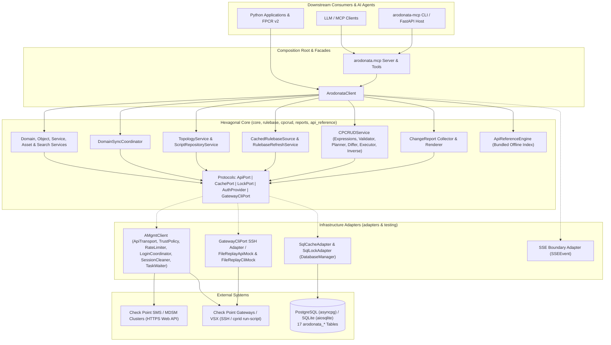

# Architecture Overview

Arodonata v2 is built on a strict **Hexagonal (Ports & Adapters)** architecture designed for high-concurrency asynchronous execution, multi-worker database safety, and zero-leak security hygiene.

## System Context & Component Diagram

## Key Architectural Invariants

1. **Pure Core Domain (`arodonata.core`, `arodonata.rulebase`, `arodonata.cpcrud`, `arodonata.reports`, `arodonata.api_reference`)**:
   - Business logic depends exclusively on typed Python `Protocol` interfaces (`ApiPort`, `CachePort`, `LockPort`, `AuthProvider`, `GatewayCliPort`).
   - Core modules never import `aiohttp`, `asyncpg`, `aiosqlite`, or HTTP transport primitives directly.
2. **Database-First Synchronization & Multi-Worker Coordination**:
   - All cached state lives in **17 `arodonata_*` SQLModel tables** ([Database Schema Reference](database-schema.md)).
   - Schema initialization is serialized across worker processes (`pg_advisory_xact_lock` on PostgreSQL, `BEGIN IMMEDIATE` on SQLite) and tracked by SHA-256 metadata digest in `arodonata_schema_version`.
   - `arodonata_distributed_locks` coordinates cross-process critical sections with automatic background heartbeat renewal across domain syncs, domain list discovery, `LoginGate` serialization, and distributed `RateLimiter` slots.
3. **Strict Read vs Write Session Separation**:
   - Read operations share a persistent, credential-bound read-only session in `arodonata_sid_cache` (system domain keyed as `"System Data"`). Mutating commands (`add-*`, `set-*`, `delete-*`, `publish`, `discard`, `run-script`) are rejected on the shared session.
   - Write operations open an isolated `WriteSession` (`create_dedicated_session`) with an in-memory `SessionOverlay` bound via `contextvars` so callers immediately read their own uncommitted object/service writes before `publish`. CPCRUD also supports staged sessions (`no_publish=True, keep_session=True`, finalized via `publish_staged_session` / `discard_staged_session`), while `ScriptRepositoryService` executes scripts inside dedicated non-read-only sessions without `publish`/`discard`.
4. **Defense-in-Depth Security Hygiene**:
   - Session tokens (`sid`), API keys, and passwords are redacted (`"***REDACTED***"`) in all `repr()`, logs, OpenTelemetry span attributes, exception messages, and MCP tool outputs (`redact_sid(..., known_sids=...)`).
   - TLS certificates are verified post-handshake and pre-request against SHA-256 DER fingerprints (`pinned`, `tofu`, or `lab-memory`).
5. **Provider-Agnostic Observability**:
   - Functions decorated with `@traced` (`arodonata.core.telemetry`) emit OpenTelemetry spans via `opentelemetry-api` (`arlogi.otel.traced`) without ever owning or overriding the host application's global `TracerProvider`.

## Subsystems & Package Map

| Package | Responsibility |
| --- | --- |
| `arodonata.client` & `arodonata.core` | Composition root (`ArodonataClient`), typed settings/contexts, error hierarchy, five core protocols, domain/object/service/asset/search/topology/script services, and background warm-up |
| `arodonata.rulebase` | Normalized policy package, inline layer, section, SmartConsole numbering, local filtering (`RulebaseRefreshService`, `CachedRulebaseSource`), and CPCRUD export |
| `arodonata.cpcrud` | Declarative Policy-as-Code engine: shorthand expression parser, draft-07 schema validator, `HybridStateReader`, differ, cleanup-aware planner, executor (retries + staged sessions), and inverse rollback builder |
| `arodonata.reports` | Auditable `ChangeReport` collector (session/range scopes + offline `build_change_report_from_plan`), live rule placement numbering, and self-contained HTML/Markdown/JSON renderer |
| `arodonata.api_reference` | Offline bundled `cp_api_index.json.gz` engine (`ApiReferenceEngine`) supporting version-filtered command search, payload schema description, and offline validation |
| `arodonata.mcp` | Streamable-HTTP MCP server (`arodonata-mcp` CLI + `ArodonataASGIApp`), static bearer / JWT / host auth, DNS-rebinding & Origin guards, HMAC-signed CPCRUD plans, and read/topology/API tools |
| `arodonata.testing` | Enterprise replay dataset generator, stateful in-process emulator (`FileReplayApiMock`, `FileReplayCliMock`), and standalone HTTPS mock server (`CheckPointReplayHttpServer`) |
