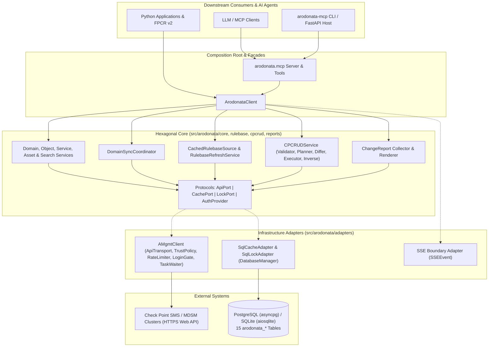

# Architecture Overview

Arodonata v2 is built on a strict **Hexagonal (Ports & Adapters)** architecture designed for high-concurrency asynchronous execution, multi-worker database safety, and zero-leak security hygiene.

## System Context & Component Diagram

## Key Architectural Invariants

1. **Pure Core Domain (`arodonata.core`, `arodonata.rulebase`, `arodonata.cpcrud`, `arodonata.reports`)**:
   - Business logic depends exclusively on typed Python `Protocol` interfaces (`ApiPort`, `CachePort`, `LockPort`, `AuthProvider`).
   - Core modules never import `aiohttp`, `asyncpg`, `aiosqlite`, or HTTP transport primitives directly.
2. **Database-First Synchronization & Multi-Worker Coordination**:
   - All cached state lives in **15 `arodonata_*` SQLModel tables** ([Database Schema Reference](database-schema.md)).
   - Schema initialization is serialized across worker processes (`pg_advisory_xact_lock` on PostgreSQL, `BEGIN IMMEDIATE` on SQLite) and tracked by SHA-256 metadata digest in `arodonata_schema_version`.
   - Domain synchronization acquires database-backed distributed locks (`arodonata_distributed_locks`) with automatic background TTL heartbeat renewal.
3. **Strict Read vs Write Session Separation**:
   - Read operations share a persistent, credential-bound read-only session in `arodonata_sid_cache`. Mutating commands (`add-*`, `set-*`, `delete-*`, `publish`, `discard`) are strictly rejected on the shared session.
   - Write operations open an isolated `WriteSession` (`create_dedicated_session`) with an in-memory `SessionOverlay` bound via `contextvars` so callers immediately read their own uncommitted writes before `publish`.
4. **Defense-in-Depth Security Hygiene**:
   - Session tokens (`sid`), API keys, and passwords are redacted (`"***REDACTED***"`) in all `repr()`, logs, OpenTelemetry span attributes, exception messages, and MCP tool outputs (`redact_sid(..., known_sids=...)`).
   - TLS certificates are verified post-handshake and pre-request against SHA-256 DER fingerprints (`pinned`, `tofu`, or `lab-memory`).
5. **Provider-Agnostic Observability**:
   - Functions decorated with `@traced` (`arodonata.core.telemetry`) emit OpenTelemetry spans via `opentelemetry-api` (`arlogi.otel.traced`) without ever owning or overriding the host application's global `TracerProvider`.
