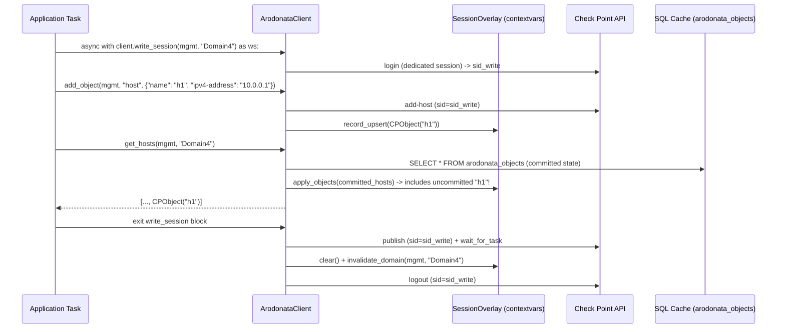

# Sessions, MDSM & `SessionOverlay`

Check Point Management servers tie every uncommitted change and object lock to a session identifier (`sid`). Sharing a single `sid` across concurrent tasks or mutating on a read session leads to accidental publishes of another user's changes or deadlocked objects.

Arodonata v2 enforces a strict architectural separation between **shared read-only sessions** and **isolated write sessions**.

## 1. Shared Read-Only Sessions (`arodonata_sid_cache`)

- All read commands (`show-*`, `where-used`, `verify-policy`) use a pooled session cached in the `arodonata_sid_cache` table per `(mgmt_name, domain_name, auth_identity_hash)`.
- **Hard Read-Only Guard**: `AMgmtClient` checks `is_readonly_command(command)` before using a cached `sid`. Attempting to run `add-*`, `set-*`, `delete-*`, `publish`, or `discard` on the shared session raises `SessionStateError` immediately.
- **Persistent Reuse Across CLI Invocations**: When `ARODONATA_DATABASE_URL` points to a file-backed SQLite or PostgreSQL database, `await client.close()` leaves valid `arodonata_sid_cache` sessions alive so subsequent CLI commands or worker processes reuse the existing login without triggering Check Point's login rate limiter.
- **Startup `SessionCleaner`**: On initialization, `SessionCleaner` inspects open sessions created by Arodonata (`application="arodonata"`) and logs out only orphaned idle sessions that have `changes == 0` and `locks == 0`.

## 2. Isolated `WriteSession` & `SessionOverlay`

Whenever you open `async with client.write_session(mgmt_name, domain) as ws:`, Arodonata:

1. Calls `create_dedicated_session()` to open a fresh Check Point session outside `arodonata_sid_cache`.
2. Binds the `WriteSession` and its `SessionOverlay` to Python's `contextvars` for the current async task tree.
3. Intercepts every `add-<type>`, `set-<type>`, and `delete-<type>` call inside that `with` block and records the created, modified, or deleted object/service in `ws.overlay`.
4. Automatically merges `ws.overlay` into all cached read helpers (`get_hosts`, `get_objects`, `get_services`, `find_object`, `search_objects`, `get_group_members`) called within the same async context!
5. On normal block exit (`publish_on_exit=True`), executes `publish`, waits for the task to complete, clears the overlay, invalidates the domain cache so the next read fetches the new published revision, and logs out the dedicated `sid`.
6. On exception, automatically executes `discard` (shielded via `asyncio.shield`) and logs out cleanly so no locks remain orphaned on the Check Point server.

## 3. Login Throttling Recovery (`LoginGate`)

Check Point R81.20 / R82 Management servers enforce a strict login rate limit; exceeding it returns HTTP `400` / `429` (`err_too_many_requests` / `"Too many login attempts"`).

- `LoginGate` (`src/arodonata/adapters/checkpoint/rate_limiter.py`) serializes login attempts per MDS member IP with inter-login spacing and, upon detecting a throttle response, opens a `login_throttle_window` (`70.0s` default) cooldown gate across all waiting tasks up to `login_max_wait` (`900.0s`).
- Genuine authentication failures (`InvalidCredentialsError`, including Check Point R82 `"Authentication to server failed."` / `err_login_failed`) fail fast immediately without waiting or retrying.
