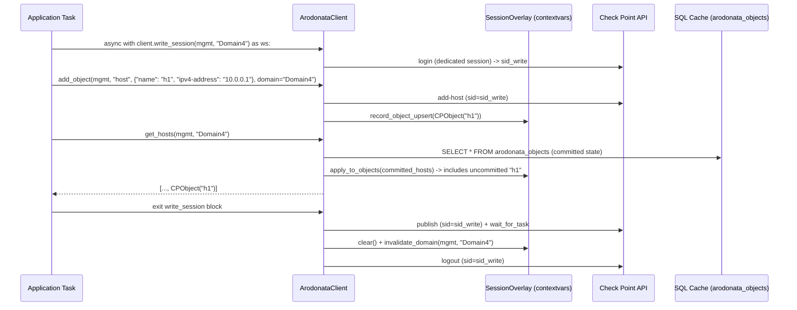

# Sessions, MDSM & `SessionOverlay`

Check Point Management servers tie every uncommitted change and object lock to a session identifier (`sid`). Sharing a single `sid` across concurrent tasks or mutating on a read session leads to accidental publishes of another user's changes or deadlocked objects.

Arodonata v2 enforces a strict architectural separation between **shared read-only sessions** and **isolated write sessions**.

## 1. Shared Read-Only Sessions (`arodonata_sid_cache`)

- **Credential-Bound Pooling (`C4`)**: All read commands (`show-*`, `where-used`, `verify-policy`) use a pooled session stored in `arodonata_sid_cache` keyed by `"{mgmt_name}:{domain_name}:{auth_identity}"`, where `domain_name` normalizes `None` to `SYSTEM_DOMAIN_KEY` (`"System Data"`) and `auth_identity` is the non-secret HMAC-SHA256 `AuthContext.identity_key` (`"{principal}:{digest}"`). Distinct users or API keys in multi-tenant hosts never collide or share a `sid`.
- **Hard Read-Only Guard**: `AMgmtClient` checks `is_readonly_command(command)` before using a cached `sid`. Attempting to run `add-*`, `set-*`, `delete-*`, `publish`, `discard`, or `run-script` on the shared session raises `SessionStateError` immediately.
- **Persistent Reuse Across Invocations**: When configured with PostgreSQL or file-backed SQLite, `await client.close()` leaves valid `arodonata_sid_cache` sessions alive so subsequent worker invocations reuse existing logins without triggering Check Point's login rate limiter (auto-logout on close runs only when `logout=True` or on an owned ephemeral `:memory:` SQLite DB).
- **Startup & Max-Sessions `SessionCleaner`**: `SessionCleaner` (`src/arodonata/adapters/checkpoint/sessions.py`) inspects open Web API sessions where `application == "arodonata"` or `session-name` starts with `"arodonata"` with `changes == 0` and `locks == 0`. It discards orphaned sessions via **`discard {"uid": target_uid}`** (never `logout`, which cannot close foreign UIDs) while leaving `SmartConsole`, third-party, and dirty sessions untouched. When `seed_system_sid=True` and `"System Data"` is cold, it seeds its inspection SID directly into `arodonata_sid_cache`. Startup cleanup is also invoked on max-sessions errors and skips cleanly in cold `"dynamic"` mode with no active auth.

## 2. Isolated `WriteSession` & `SessionOverlay`

Whenever you open `async with client.write_session(mgmt_name, domain) as ws:`, Arodonata:

1. Calls `create_dedicated_session()` to open a fresh Check Point session outside `arodonata_sid_cache` (applying `session_name` / `session_description` from `UserContext` if set).
2. Binds the `WriteSession` and its `SessionOverlay` to Python's `contextvars` for the current async task tree.
3. Intercepts every `add-<type>`, `set-<type>`, and `delete-<type>` call for cacheable objects and services and records them via `ws.overlay.record_object_upsert()`, `record_object_delete()`, `record_service_upsert()`, and `record_service_delete()`. Non-object/non-service commands (`NON_OVERLAY_MUTATION_TARGETS` such as rules, sections, layers, packages, domains, and repository scripts) bypass `SessionOverlay`.
4. Automatically merges `ws.overlay` (`apply_to_objects()`, `apply_to_services()`) into cached read helpers (`get_hosts`, `get_objects`, `get_services`, `find_object`, `search_objects`, `get_group_members`) called within the same async context.
5. On normal block exit (`publish_on_exit=True`), executes `publish`, waits for the task to complete, clears the overlay, invalidates the domain cache so the next read fetches the new published revision, and logs out the dedicated `sid`.
6. On any `BaseException` (including `asyncio.CancelledError`), shields `discard` and `logout_sid()` via `asyncio.shield` so no locks remain orphaned on Check Point.

## 3. Authentication Modes & Context Propagation

`ArodonataSettings` resolves credentials across three mutually validated modes (`api_key`, `credential`, and `dynamic`):

- **`client.auth_context(AuthContext(...))`**: Scopes per-request credentials (`api_key` or `username`/`password` + optional `user_id`) via `contextvars` for multi-tenant APIs/MCP hosts.
- **`AuthProvider`**: Optional dynamic credential callback queried when no static or context-bound credential is present; notifies `on_auth_failed()` and fast-fails evicted identities across retries.
- **`client.user_context(UserContext(...))`**: Propagates operator `user_id`, `username`, `session_name`, `session_description`, and `client_id` metadata onto dedicated Check Point write sessions.

## 4. MDSM Discovery, Failover & Login Throttling Recovery

- **Domain & Active CMA Failover**: `DomainService` caches `show-domains` (falling back to `details-level="standard"` if RBAC rejects `full` while preserving cached CMA IPs) with a `1h` TTL (`domain_list_ttl`). If a read-only call hits a stale standby CMA IP, `LoginCoordinator` clears cached SIDs and re-resolves active CMA IPs via `DomainService` / `show-global-domain`. Coalesced background keepalive sweeps (`RateLimiter.run_coalesced_keepalive`) keep long-lived sessions valid and evict expired SIDs immediately (`"object not found"` / revision reverts).
- **Login Throttling Recovery (`LoginGate`)**: Check Point R81.20 / R82 Management servers enforce a strict login rate limit returning HTTP `400` / `429` (`err_too_many_requests` / `"Too many login attempts"`). `LoginGate` (`src/arodonata/adapters/checkpoint/rate_limiter.py`) serializes login attempts per MDS member IP with inter-login spacing and opens a shared `login_throttle_window` (`70.0s` default) cooldown gate up to `login_max_wait` (`900.0s`), while genuine auth failures (`InvalidCredentialsError`, e.g. `"Authentication to server failed."`) fail fast with zero retries.

## 5. Staged CPCRUD Sessions & Repository Script Execution

- **CPCRUD Staged Sessions**: `cpcrud.apply(plan, no_publish=True, keep_session=True)` retains the uncommitted write session cleanly and records `StagedSessionInfo` (`sid` redacted). Later calls to `publish_staged_session()` or `discard_staged_session()` validate session provenance and adopt the session via `take-over-session` (with `switch-session` fallback).
- **`ScriptRepositoryService` Execution**: `run_repository_script()` runs `run-script` inside a dedicated non-read-only session (not `arodonata_sid_cache`) and closes cleanly without calling `publish` or `discard`.
