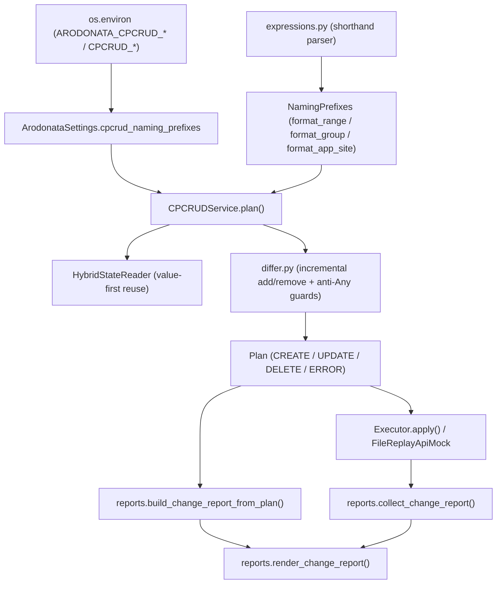

# Design: Incremental Rule and URL-List Diffs, Naming Profiles, and Dry-Run Plan ChangeReports

## Context

`arodonata.cpcrud` already implements declarative schema validation (`checkpoint_ops_schema.json`), `HybridStateReader`, `Planner`, `Differ`, `Executor`, and `build_inverse_template`, while `arodonata.reports` provides `collect_change_report` and `render_change_report` (see [proposal.md](./proposal.md) for motivation and [specs/](./specs/cpcrud/spec.md) for behavioral contracts).

Currently:

- `NamingPrefixes` supports prefix strings (`Host_`, `Net_`, `IPR_`, `grp`, `TCP_`, `UDP_`, `ICMP_`), hardcodes `IPR_<first>-<last>`, has no suffix or compressed-octet range option, has no `app_site` naming helpers, and is not wired into `ArodonataSettings`.
- `differ.py` supports incremental `{"add": [...], "remove": [...]}` only for `group` and `service-group` `members`; `application-site` `url-list` and `RuleOperation` list fields (`source`, `destination`, `service`, `protected-scope`, `site-category`, `install-on`) accept full list replacements only.
- `Planner._normalize_verb` treats `"set"`/`"update"` differently from `"present"` only in intent, so missing targets during `set`/`update` fall through to `CREATE` instead of failing closed.
- `ChangeReport` rendering requires an executed Check Point session (`show-changes`), leaving Dry-Run callers unable to reuse `render_change_report` before opening write sessions.

## Goals / Non-Goals

**Goals:**

- Resolve customer-configurable CPCRUD naming profiles from `os.environ` via `ArodonataSettings` while keeping all existing `NamingPrefixes()` defaults intact for backward compatibility.
- Centralize shorthand parsing (hosts, CIDRs, full/short IPv4 ranges, `.domain`, `*domain`/`*.domain` regex apps, services, inline groups) in `arodonata.cpcrud.expressions` so downstream consumers share one parser.
- Support idempotent `{"add": [...], "remove": [...]}` operations across `application-site` `url-list` and list-valued rule cells (`source`, `destination`, `service`, and future rule types `protected-scope`, `site-category`, `install-on`), plus strict safety guards (`set`/`update` existence, anti-`Any`-widening, and `"Any"` collision).
- Synthesize offline `ChangeReport` documents directly from a `Plan` for Dry-Run HTML/Markdown/JSON previews.

**Non-Goals:**

- Implicitly reading `.env` files inside `ArodonataSettings` (forbidden by library `configuration` invariants).
- Renaming or modifying legacy-named Check Point objects when their value (`ip`, `subnet+mask`, `first-last`, `url-list`) already matches during `on_ip_conflict="reuse"`.
- Introducing Check Point Web API session mutations for `build_change_report_from_plan` (must remain 100% offline).

## Decisions

### 1. Backward-Compatible `NamingPrefixes` Extensions & Env Wiring

- **Decision**: Extend `NamingPrefixes` with additive optional fields (`range_separator: str = "-"`, `compress_range_same_subnet: bool = False`, `group: str = "grp"`, `group_suffix: str = ""`, `app_site: str = "Site_"`, `app_site_wildcard_marker: str = "_"`) and methods `format_group(base_name)` and `format_app_site(domain, *, is_wildcard=False)`. In `format_address_range`, when `compress_range_same_subnet=True` and both IPv4 addresses share the first three octets (`a.b.c.X` and `a.b.c.Y`), emit `f"{self.address_range}{first_ip}{self.range_separator}{last_ip.rsplit('.', 1)[1]}"` (producing `Range_10.1.1.1_9`); otherwise emit `f"{self.address_range}{first_ip}{self.range_separator}{last_ip}"`.
- **Rationale**: Preserves 100% compatibility for existing callers (`IPR_10.1.1.1-10.1.1.9`, `grpName`, `Site_domain`) while allowing downstream apps like MMP to configure `Range_10.1.1.1_9`, `Name_Grp`, and `Site__chinacloudapi.cn` purely via env vars (`ARODONATA_CPCRUD_*` / `CPCRUD_*`) or `naming_prefixes` overrides.
- **Alternative Considered**: Changing default prefixes in `NamingPrefixes` globally. Rejected because existing `arodonata` specs and tests explicitly assert `Host_`, `Net_`, `IPR_`, `grp`, `TCP_`, `UDP_`, `ICMP_`.

### 2. Canonical Expression Parser in `arodonata.cpcrud.expressions`

- **Decision**: Add `src/arodonata/cpcrud/expressions.py` with pure helpers (`parse_range_token`, `wildcard_domain_to_cp_regex_urls`, `parse_app_site_expression`, `parse_group_expression`, `parse_service_expression`, `parse_object_expression`) accepting `prefixes: NamingPrefixes | None = None`. Support both `*chinacloudapi.cn` and `*.chinacloudapi.cn` (normalizing domain to `"chinacloudapi.cn"` and regex list to `["\\/chinacloudapi\\.cn", "\\.chinacloudapi\\.cn"]`, naming with `prefixes.format_app_site(domain, is_wildcard=True)` -> `Site__chinacloudapi.cn`), and shorthand ranges like `10.1.1.1-9` (and `Range_10.1.1.1_9`).
- **Rationale**: Eliminates parser duplication across `MMP` plugins and downstream automation ("Delegate, Never Duplicate").
- **Alternative Considered**: Keeping parsing inside MMP `rule_creator`. Rejected per `openspec/config.yaml` and user decision to consolidate shared logic in `arodonata`.

### 3. Unified Incremental List-Cell Diff Helper & Anti-`Any` Guards

- **Decision**: Compute both full `list[str]` replacements and `{"add": [...], "remove": [...]}` patches consistently in `differ.py`:
  - **Policy rule list cells (`source`, `destination`, `service`, `protected-scope`, `site-category`, `install-on`)**: Validate the requested patch against the `existing` rule snapshot (detecting `Outcome.UNCHANGED`, blocking empty cells to prevent silent Check Point widening to `"Any"`, blocking incremental `add` of `"Any"`, and blocking `"add"` onto an `"Any"` cell unless `"Any"` is explicitly listed in `"remove"`). Emit Check Point's incremental `{"add": effective_adds, "remove": wire_removes}` payload in `update_payload` (stripping `"Any"` from wire `remove` since Check Point replaces `Any` implicitly) while populating `FieldChange(old_value=list(norm_exist), new_value=member_op, added_items=effective_adds, removed_items=effective_removes)`. Share `build_effective_obj_dict` and `deref_rule_list` in `rule_identity.py` across `differ.py` and `planner.py` (`_build_prior_rule_state`) so diff and `inverse()` stay in sync.
  - **`application-site.url-list`**: Accept `{"add": [...], "remove": [...]}` in declarative templates, normalize non-regex URL comparisons case-insensitively across `HybridStateReader` and `differ.py`, enforce the non-empty URL invariant whenever `application-signature` is absent, and emit the merged `url-list: list[str]` in `update_payload` for universal `set-application-site` compatibility across R80.40–R82 while recording `FieldChange(old_value=old_urls, new_value=merged_urls, added_items=effective_adds, removed_items=effective_removes)`.
- **Rationale**: Combines dry-run pre-validation and crisp diff/rollback capture with native Check Point Web API incremental semantics on rules and universal `set-application-site` compatibility.
- **Alternative Considered**: Emitting full replacement lists for every incremental rule edit or sending `url-list: {add, remove}` directly to `set-application-site`. Rejected because full-list rule updates enlarge change noise, while `set-application-site` expects `url-list` arrays across Check Point API versions.

### 4. Strict `set` / `update` Existence Check in `Planner`

- **Decision**: When `_normalize_verb(spec)` returns `"set"` (from `operation`/`action`/`state` in `("set", "update")`) and no matching existing entity is found in `_plan_object_step`, `_plan_service_step`, `_plan_group_step`, or `_plan_rule_step`, OR when a rule carries incremental `{add, remove}` cell deltas and no existing rule matched under any verb (including `present`), return `Outcome.ERROR` (`_make_error_action`) instead of executing Case B/C (`CREATE`).
- **Rationale**: Prevents typos in UID/name during update workflows or unmatched incremental rule patches from silently creating unwanted objects, duplicate rules, or allow-all `Any` rules. `"present"` / `"add"` continue to support create-or-update idempotency for complete specs.

### 5. Offline Dry-Run `ChangeReport` Synthesis (`build_change_report_from_plan`)

- **Decision**: Add `src/arodonata/reports/plan_report.py` exposing `build_change_report_from_plan(plan: Plan, *, title: str | None = None, header_fields: Mapping[str, str] | None = None, include_unchanged: bool = False) -> ChangeReport`. Group `plan.actions` by `(mgmt_name, domain_name)` into `SessionChangeReport` entries (`session_uid="dry-run-plan"`, `session_name="Dry-Run Plan Preview"`, `numbering_source="not_applicable"`). Map `CREATE` -> `"added"`, `DELETE` -> `"deleted"`, `UPDATE` -> `"modified"`, converting `PlannedAction.diffs` into `FieldDiff` records with populated `added_items` / `removed_items` (both for `{add, remove}` dicts and list transitions like `old_list` -> `new_list`).
- **Rationale**: Reuses `render_change_report` (SmartConsole table layout, XSS escaping, inline `+item` / `-item` diff chips) for Dry Run previews without duplicating HTML templates in downstream apps.

## Risks / Trade-offs

- **Risk: Check Point `url-list` `set-application-site` payload requirements** → Check Point Management API `set-application-site` accepts full `url-list` replacement (`list[str]`) reliably across all R80.40–R82 API versions, whereas `url-list: {add, remove}` is only supported on selected object types (like `members` on groups, `source`/`destination`/`service` on rules). **Mitigation**: Accept `{add, remove}` in the declarative CPCRUD template & `differ.py` for `application-site.url-list`, compute the merged `list[str]` inside `compute_object_diff`, emit the merged `url-list: list[str]` in the `set-application-site` Web API payload while recording `FieldChange(old_value=old_urls, new_value=merged_urls, added_items=..., removed_items=...)`! This gives operators incremental template UX without risking Web API incompatibilities on `set-application-site`.
- **Risk: Downstream tests expecting `FieldChange.new_value` on group `members` to remain `{"add": ..., "remove": ...}`** → **Mitigation**: Keep `FieldChange.new_value` unchanged for `group`/`service-group` (`{"add": ..., "remove": ...}`), and add optional `added_items: list[str] = Field(default_factory=list)` and `removed_items: list[str] = Field(default_factory=list)` on `FieldChange` with defaults so existing assertions on `old_value`/`new_value` pass untouched.
- **Risk: Circular `depends_on` or missing dependency references on incremental rule edits** → **Mitigation**: Extend `_extract_rule_references(spec)` to collect names inside `{"add": [...]}` dictionaries (excluding `"remove"` targets and `"Any"`) so `Planner` orders prerequisite object/group creations before rule updates.
