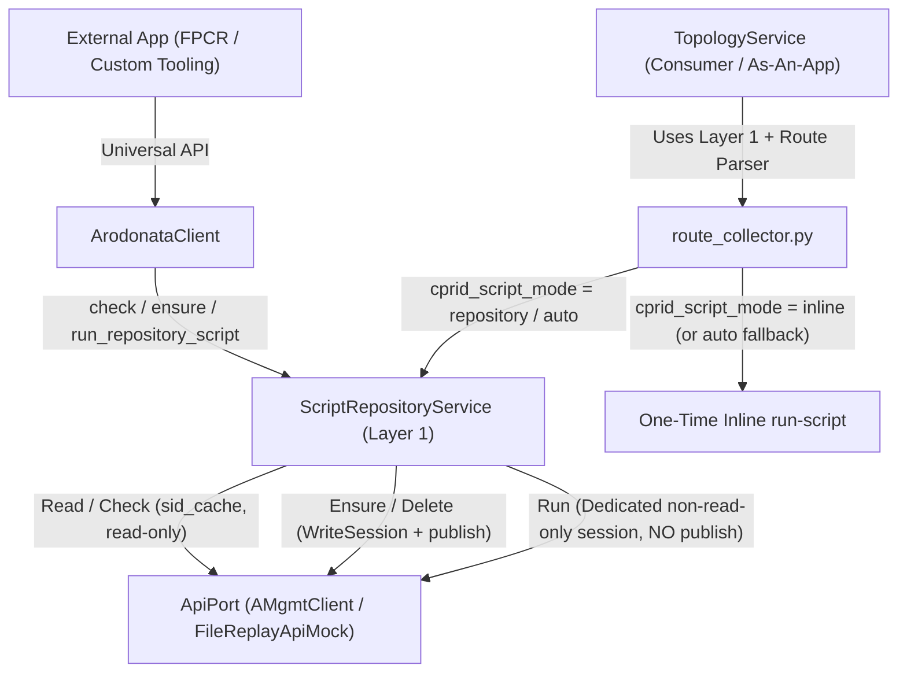

# Design: Check Point Script Repository Management & Execution (`repository-script`)

## Context

`TopologyService.collect_gateway_routes()` currently executes gateway diagnostics over `cprid` using inline `"one time"` `run-script` payloads built by `build_route_collection_script()` in `src/arodonata/core/services/route_collector.py` (see [proposal.md](./proposal.md) for motivation and [specs/client-and-facade/spec.md](./specs/client-and-facade/spec.md) / [specs/gateway-topology/spec.md](./specs/gateway-topology/spec.md) for contracts).

Live verification on Check Point MDSM (`mdsH5`, Management API `v2.2`) established four empirical constraints that govern this design:

1. **Repository execution syntax**: Check Point `run-script` executes pre-stored repository scripts only when `"script-type": "repository"` is supplied alongside `"script-name"` (or `"uid"`) without `"script"` or `"script-base64"`. Omitting `"script-type"` defaults to `"one time"` and fails validation when `"script"` is absent (`Missing parameter: [Didn't Provide script or script-base64 for one time script.]`).
2. **Permission and session isolation**:
   - Standard built-in `Read Only All` profiles deny both `"one time"` and `"repository"` scripts and force `login` into `read-only=True`, rejecting `run-script` with `HTTP 400 err_validation_failed: Operation is not allowed in read only mode`.
   - Under `Multi-Domain Profile = Domain Level Only` paired with an explicit domain assignment whose `domain-permissions-profile` grants `gateways.run-repository-script: true`, `gateways.run-one-time-script: false`, `gateways.manage-repository-scripts: "read"`, `edit-common-objects: false`, and `publish-sessions: false`, `login` opens with `read-only=None` when `"read-only": true` is omitted. In that session, Check Point accepts `"script-type": "repository"` against gateway objects (`HTTP 200`), blocks inline `"one time"` scripts (`HTTP 400 No permission to run action`), and blocks object/script mutations (`Object ... is read-only` / `Permission denied`).
3. **Positional `args` handling**: Check Point passes `args` safely as `$1`, `$2`, ... without subshell `;` expansion, though strict input validation inside the canonical bash script guarantees defense in depth across Gaia / R81.20–R82.20 versions.
4. **Domain-scoped repository**: `repository-script` objects live per domain (`add-repository-script` / `show-repository-script` require a domain session and `publish` before `run-script` in that domain can see them).

## Goals / Non-Goals

**Goals:**

- Provide a reusable, application-agnostic Layer 1 (`ScriptRepositoryService` + `ArodonataClient`) for reading, checking, idempotently provisioning, deleting, and executing any Check Point Script Repository entry (`"script-type": "repository"`) with opaque caller `args`.
- Consume Layer 1 inside `TopologyService.collect_gateway_routes()` and `route_collector.py` as Layer 2 ("as an application") via `cprid_script_mode` (`"inline" | "repository" | "auto"`) and optional custom script/args hooks.
- Preserve strict backward compatibility (`cprid_script_mode = "inline"` default) and enable safe cross-domain pipelining so an orchestrator like FPCR can collect routes in `DomainA` concurrently while prompting and provisioning the script in `DomainB`.
- Provide faithful stateful emulation of repository script CRUD, `WorkSession` isolation, and permission gating in `FileReplayApiMock`.

**Non-Goals:**

- Interactive user prompts, UI workflows, or domain-orchestration state machines inside `arodonata` (those belong in host applications such as FPCR).
- Storing repository script definitions in local SQLite/PostgreSQL cache tables (`arodonata_objects`) or `SessionOverlay`; `show-repository-script` queries Check Point directly over `sid_cache`.
- Supporting SSH execution of Management Server repository scripts (`GatewayCliPort` continues executing inline bash scripts on gateway SSH directly).

## Decisions

### 1. Two-Layer Separation: Universal Script Repository Service vs. Application Consumer

- **Decision**: Introduce `ScriptRepositoryService` (`src/arodonata/core/services/script_service.py`) and typed models/errors (`core/models/scripts.py`, `core/errors.py`) completely free of route-collection, CIDR, or VSX concepts. `ArodonataClient.run_repository_script(...)` forwards `targets` and `args` (`str` verbatim or `" ".join(str(a) for a in args)` when a `Sequence[str]` is supplied) directly to `run-script`. `TopologyService` and `route_collector.py` act purely as one consumer of that universal capability (plus exposing thin convenience helpers `check_route_collection_script` and `ensure_route_collection_script` that plug in `settings.cprid_repository_script_name` and `build_route_collection_repository_script()`).
- **Rationale**: Different downstream applications can deploy and invoke entirely different approved scripts (e.g., interface stats, BGP neighbor checks, FPCR route collection) using the exact same Check Point security and session plumbing ("Delegate, Never Duplicate").
- **Alternative Considered**: Adding repository-script logic directly inside `TopologyService` / `route_collector.py`. Rejected because it would couple a generic Check Point API feature to route parsing and force external callers to reimplement `add-repository-script` / `show-task` Base64 decoding.

### 2. Dedicated Non-Read-Only Session Handling & Error Classification

- **Decision**:
  - **Reads/Checks (`get_repository_script`, `list_repository_scripts`, `check_repository_script`)**: Route through `api.api_call(..., "show-repository-script[s]", ..., domain=domain)` so `sid_cache` read-only sessions are reused automatically with zero write sessions or `publish` calls (respecting an active `WriteSession` if the caller is already inside one).
  - **Mutations (`ensure_repository_script`, `delete_repository_script`)**: Perform a read-only `check_repository_script` first; if `exists and matches_expected`, return `action="unchanged"` immediately. Otherwise, reuse an active matching `WriteSession` (without publishing) or open an isolated `WriteSession(..., publish_on_exit=True)` to execute `add-repository-script` or `set-repository-script` and publish. Add `"repository-script"` (plus `"api-key"`, `"md-permissions-profile"`, `"domain-permissions-profile"`) to `NON_OVERLAY_MUTATION_TARGETS` in `src/arodonata/adapters/checkpoint/client.py` so `SessionOverlay` never attempts to coerce script payloads into `CPObject`.
  - **Execution (`run_repository_script`)**: Check Point rejects `run-script` in `"read-only": true` sessions (`sid_cache`). When no explicit `sid` or matching active `WriteSession` is bound, `ScriptRepositoryService` obtains a dedicated non-read-only session (`api.create_dedicated_session(mgmt_name, domain=domain, session_name=...)` or a caller-provided per-domain session getter) and logs out in `finally` without calling `publish` or `discard`.
  - **Error Mapping**: Map Check Point `generic_err_object_not_found` for the repository script on `show-repository-script` / `run-script` to `RepositoryScriptNotFoundError` (distinguishing missing/stale `targets` gateway objects on `run-script` and unsupported `< v1.9` `generic_err_command_not_found` errors as `RepositoryScriptError` / `error_code="repository_script_unsupported"`), and map permission/read-only errors (`generic_err_no_permissions`, `Operation is not allowed in read only mode`, `No permission to run action`, `is read-only`, and DMS Permission Profile rejections across both `session_getter` and inline `cprid`) to `RepositoryScriptPermissionError`. Note: Check Point errors when targeting a Domain Management Server (`To run a script on Domain Management Server, you must have a Permission Profile with Multi-Domain provisioning permissions`) also map to `RepositoryScriptPermissionError`.
- **Rationale**: Matches verified Check Point MDSM `v2.2` behavior, prevents `sid_cache` pollution, and gives host apps deterministic exception types to decide whether to prompt an RW admin or warn an RO user.

### 3. Canonical Parameterized Route Script (`arodonata-collect-routes-v1`) & Output Parity

- **Decision**: Define `DEFAULT_ROUTE_COLLECT_REPOSITORY_SCRIPT_NAME = "arodonata-collect-routes-v1"` and `build_route_collection_repository_script()` returning a single self-contained bash script taking three optional positional arguments:
  - `$1`: `max_routes` (digits-only; `0` or empty = unlimited)
  - `$2`: `vsid` (digits-only; `0` or empty = host/non-VSX)
  - `$3`: `vs_name` (non-empty string when `vsid` is unknown; matched safely via `awk -v target="$vs_name"` with zero `eval`)
  Validate `$1` and `$2` strictly against `*[!0-9]*` inside the script, preserve all existing stdout markers (`===ARODONATA_VSID_RESOLVED=`, `===ARODONATA_IP_ROUTE_START===`, `===ARODONATA_CLISH_ROUTE_START===`, `_vs_error=`, `===ARODONATA_ROUTE_LIMIT_REACHED===`, `===ARODONATA_CLISH_SKIPPED_LARGE_TABLE===`), and reuse `parse_combined_cli_routes_with_status()` without changes. Provide `format_route_collection_repository_args(target, *, max_routes=None) -> str` emitting `f"{eff_max} {eff_vsid}"` or `f"{eff_max} 0 {target.vs_name}"` (when `vs_name` contains no whitespace/control chars; failing validation on unsafe `vs_name` characters before API dispatch).
- **Rationale**: One static approved script in Check Point works across standalone Gaia gateways, cluster members, and VSX Virtual Systems while preserving 100% parser parity and preventing arbitrary command injection even if untrusted arguments were ever passed.
- **Alternative Considered**: Separate scripts per VSX context or omitting `args` by dumping every VS on a VSX chassis in one run. Rejected because dumping all VS contexts in one call breaks per-VS `GatewayCliTarget` routing isolation and fails when a host only wants one VS refreshed.

### 4. Execution Modes (`"inline"` / `"repository"` / `"auto"`) & Route Status Error Codes

- **Decision**:
  - Default `ArodonataSettings.cprid_script_mode` to `"inline"` so all existing deployments and mock datasets continue unchanged unless configured (`ARODONATA_CPRID_SCRIPT_MODE="repository"` or `"auto"`) or overridden per call via `collect_gateway_routes(..., cprid_script_mode=..., repository_script_name=..., repository_script_args_fn=...)`.
  - In `"repository"` mode: execute strictly via `ScriptRepositoryService.run_repository_script`; never fall back to inline `"one time"` scripts. When `RepositoryScriptNotFoundError` or `RepositoryScriptPermissionError` occurs, record `GatewayCliResult(success=False, error_code="repository_script_not_found" | "repository_script_permission_denied", ...)` and propagate `error_code` onto `GatewayRouteCollectionStatus`.
  - In `"auto"` mode: resolve per-domain mode once via a single-flight `AutoScriptModeResolver` before sibling targets claim management concurrency slots; attempt repository execution on the prober first and fall back to inline `"one time"` only on `repository_script_not_found` or `repository_script_unsupported` (never falling back on permission denials or stale gateway target errors). Do **not** silently fall back on `RepositoryScriptPermissionError` if both inline and repository are denied, or if the user explicitly configured `"repository"`.
- **Rationale**: Keeps least-privilege `"repository"` deployments strictly fail-closed while allowing gradual rollouts in `"auto"` mode without hitting `Missing script` repeatedly for every gateway in an unprovisioned domain.

### 5. Concurrent Cross-Domain Pipelining Isolation

- **Decision**: Ensure `collect_gateway_routes` never shares or leaks `WriteSession` `contextvars` across domains, and ensure `_get_cprid_session(mgmt_name, domain)` reuses one dedicated non-read-only session per `(mgmt_name, domain)` for `run-script` only when `get_write_session(mgmt_name=mgmt_name, domain_name=domain)` is `None` (already domain-scoped!). In `ScriptRepositoryService.ensure_repository_script`, acquire a dedicated `WriteSession` strictly scoped to `(mgmt_name, domain)` only if the read-only check determines an add/update is required. Because `LoginGate` and `RateLimiter` operate at MDS IP granularity without blocking independent domain sessions, `collect_gateway_routes(domain="DomainA")` and `ensure_repository_script(domain="DomainB")` safely execute concurrently.
- **Rationale**: Directly enables FPCR's interactive UX where Domain A collects live routes while the engineer approves provisioning in Domain B.

## Risks / Trade-offs

- **[Risk] Check Point versions < R81.20 (`v1.9` added `repository-script` in R81.20)** → On older management servers, `add-repository-script` or `show-repository-script` returns `generic_err_command_not_found`. **Mitigation**: Preserve `cprid_script_mode="inline"` as default; document `v1.9+` (R81.20+) requirement for repository mode; in `"auto"` mode, handle missing command/object errors gracefully by falling back to inline.
- **[Risk] Re-running `ensure_repository_script` after a body update on future library upgrades** → Naming the canonical script `arodonata-collect-routes-v1` versions the contract cleanly, and `ensure_repository_script` normalizes line endings (`\r\n` -> `\n`) and trailing whitespace before comparing `script-body` so harmless Check Point formatting normalization never triggers spurious `set-repository-script` publishes.
- **[Risk] `WriteSession` `contextvars` bleed if an external caller wraps multiple domains in one outer session** → `get_write_session(mgmt_name=mgmt_name, domain_name=dom_key)` already filters by `(mgmt_name, domain_name)`, so a `WriteSession` opened for `DomainB` will never be selected by `collect_gateway_routes` targeting `DomainA`. Dedicated unit/replay tests will verify concurrent `DomainA` collection + `DomainB` provisioning explicitly.
